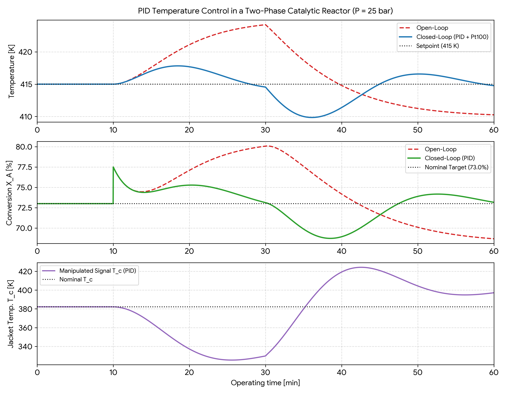

# catalytic-reactor-pid-control
PID temperature control with RTD Pt100 sensor in a two-phase catalytic reactor at 25 bar (73% nominal conversion) for waste valorization. MATLAB/Octave simulation and technical report in EN, ES, and PT.
# PID Temperature Control in a Two-Phase Catalytic Reactor (`P = 25 bar`)

Dynamic modeling, primary sensor selection, and closed-loop PID temperature control of a continuous stirred-tank catalytic reactor (CSTR) operating under constant two-phase pressure ($25.0\text{ bar}$) for agro-industrial waste valorization, calibrated to achieve a **nominal conversion efficiency of $73.0\%$** at $415.0\text{ K}$.

---

## 1. Process Overview & Engineering Problem

In catalytic hydroprocessing and valorization of agro-industrial waste streams, maintaining thermal stability inside a pressurized two-phase reactor (liquid-catalyst slurry with gas saturation at $25.0\text{ bar}$) is critical to prevent catalyst deactivation and selectivity loss.

* **Operating Pressure ($P$):** $25.0\text{ bar}$ (constant two-phase equilibrium)
* **Nominal Setpoint ($T_{sp}$):** $415.0\text{ K}$ ($141.85\,^\circ\text{C}$)
* **Target Conversion ($X_{A,\text{nom}}$):** $73.0\%$ ($\tau = 500\text{ s}$)
* **Catalyst System:** $\text{Ni-Mo}/\gamma\text{-Al}_2\text{O}_3$ slurry ($E_a = 65.0\text{ kJ/mol}$, $\Delta H_r = -95.0\text{ kJ/mol}$)
* **Primary Sensor:** Industrial **4-wire RTD Pt100 (Class A)** inside an **AISI 316L tapered thermowell** ($\tau_{\text{sens}} = 8.0\text{ s}$) with $4\text{--}20\text{ mA}$ / HART transmitter

---

## 2. Mathematical Model & Control Law

### Coupled Mass, Energy, and Sensor Dynamics

$$\frac{dC_A}{dt} = \frac{F}{V}(C_{A0} - C_A) - k_0 \exp\left(-\frac{E_a}{RT}\right) C_A$$

$$\frac{dT}{dt} = \frac{F}{V}(T_0 - T) + \frac{(-\Delta H_r)}{\rho C_p} k_0 \exp\left(-\frac{E_a}{RT}\right) C_A - \frac{UA}{\rho C_p V}(T - T_c)$$

$$\frac{dT_m}{dt} = \frac{T - T_m}{\tau_{\text{sens}}}$$

### Discrete PID Control with Derivative-on-Measurement & Anti-Windup

$$T_c(t) = T_{c,\text{nom}} + K_c \left[ e(t) + \frac{1}{\tau_I} \int_0^t e(\tau)\,d\tau - \tau_D \frac{dT_m(t)}{dt} \right], \quad e(t) = T_{sp} - T_m(t)$$

* **Controller Tuning:** $K_c = 4.5\text{ K/K}$, $\tau_I = 140.0\text{ s}$, $\tau_D = 12.0\text{ s}$
* **Actuator Saturation Limits:** $320.0\text{ K} \le T_c \le 430.0\text{ K}$ with conditional integration anti-windup

---

## 3. Simulation Results & Load Disturbance Rejection

The system is evaluated over a $60\text{-minute}$ ($3600\text{ s}$) operating horizon against two sequential step disturbances:
1. **$t = 10\text{ min}$ ($600\text{ s}$):** $+20\%$ step increase in waste substrate feed concentration ($C_{A0}: 1200 \rightarrow 1440\text{ mol/m}^3$).
2. **$t = 30\text{ min}$ ($1800\text{ s}$):** $-10\text{ K}$ step drop in feed temperature ($T_0: 385 \rightarrow 375\text{ K}$).

| Performance Metric | Open-Loop ($T_c = \text{const}$) | Closed-Loop (PID + Pt100) | Improvement |
| :--- | :---: | :---: | :---: |
| **Initial Nominal Conversion ($X_A$)** | $73.00\%$ | $73.00\%$ | — |
| **Peak Reactor Temperature ($T_{\max}$)** | $424.20\text{ K}$ | $417.83\text{ K}$ | $-6.37\text{ K}$ thermal overshoot |
| **Final Conversion at $t = 60\text{ min}$** | $68.68\%$ | $73.16\%$ | Restored to $73.0\%$ target |
| **Integral Absolute Error ($\text{IAE}$)** | $12\,848.2\text{ K}\cdot\text{s}$ | $5\,450.6\text{ K}\cdot\text{s}$ | **$-57.6\%$ error reduction** |



---

## 4. Repository Structure & Multilingual Documentation

```text
catalytic-reactor-pid-control/
├── README.md
├── LICENSE
├── src/                                      # MATLAB & GNU Octave scripts (zero toolbox dependencies)
│   ├── reactor_control_pid_en.m              # English version
│   ├── reactor_control_pid_es.m              # Spanish version
│   └── reactor_control_pid_pt.m              # Portuguese version
├── docs/                                     # Full LaTeX-compiled engineering reports (PDF)
│   ├── catalytic_reactor_pid_control_en.pdf  # English technical report
│   ├── reactor_catalitico_control_pid.pdf    # Spanish technical report
│   └── reator_catalitico_controle_pid_pt.pdf # Portuguese technical report
└── results/                                  # High-resolution simulation plots (300 DPI)
    ├── reactor_pid_results_en.png
    ├── reactor_pid_resultados_es.png
    └── reactor_pid_resultados_pt.png
